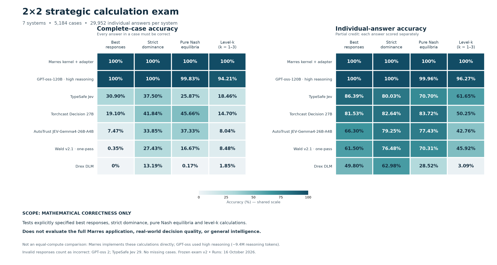

# Strategic 2×2 calculation benchmark

A reproducible, task-specific evaluation of **best responses, strict dominance, pure Nash equilibria and level-k calculations**. Frozen exam v2 contains **5,184 cases and 29,952 individual answers** across seven evaluated systems.

> **Scope: mathematical correctness only.** This benchmark tests explicitly specified 2×2 calculations. It does not evaluate the full Marres application, real-world decision quality, or general intelligence. It is not an equal-compute comparison.

**Licensing:** benchmark software is [Apache-2.0](LICENSE). Dataset, model-output and documentation licensing are separate; see [licensing scope](LICENSE.md).



## Questions and answers

- [Questions](data/questions/requests.jsonl): opaque `case_id` plus `payload` containing state and questions. Send only the payload to a model.
- [Answer key](data/answers/answers.jsonl): the same `case_id`, with exact Boolean or categorical answers.
- [Case metadata](data/metadata/cases.jsonl), [catalogue crosswalk](data/metadata/bruns-crosswalk.json), [provenance](data/metadata/provenance.jsonl).
- [108-case pilot IDs](data/questions/pilot.json), selected before model results.
- [Manifest](data/manifest.json): original frozen byte hashes, remapped to this directory layout.

| Section | Cases | Answers per case | Total answers |
|---|---:|---:|---:|
| Best responses | 576 | 8 | 4,608 |
| Strict dominance | 576 | 4 | 2,304 |
| Pure Nash equilibria | 576 | 4 | 2,304 |
| Level-k, levels 1–3 | 3,456 | 6 | 20,736 |

The 576 labelled strict ordinal matrices represent four action orientations of 144 catalogue classes, not 576 fundamentally distinct game types. Variants are correlated. Level-k additionally uses three numerical utility spacings and two initial-belief settings; ordinal rankings alone do not determine expected-utility calculations.

## Reproduce offline

Python 3.10+; standard library only. No credentials, model downloads or API calls:

```sh
python3 reproduce.py
python3 -m unittest -v
python3 score.py results/predictions/gpt-oss.jsonl --out /tmp/gpt-oss-scores.json
```

`reproduce.py` verifies frozen hashes, regenerates every answer with two separate implementations, and reproduces all saved score JSONs. Both oracle implementations were developed in the same workflow; this is not an external audit. The included data are sufficient for offline validation.

## Results

[Full results and limitations](results/REPORT.md) include both accuracy tables. **Complete-case accuracy** is primary: all answers in a case must match. Individual-answer accuracy provides partial credit. Invalid/missing cases count incorrect. GPT-oss has two invalid responses and TypeSafe Jev has 29; no evaluated case is missing.

Marres denotes a calculation kernel plus an exam adapter, not the full application. Its implementation is not included. GPT-oss-120B used high reasoning and about 9.4 million reasoning tokens. The five System One models used model-specific decision interfaces. Model formatting, compute and hosting differ; this is not a controlled latency comparison.

Normalized predictions retain answers, available probabilities and latency. Raw provider transcripts, reasoning traces, provider request IDs and infrastructure details are excluded. Source prediction-file hashes preserve a link to the original experiment records; public files alone cannot audit original server responses or prove execution. See [protocol](docs/PROTOCOL.md).

## Machine administration

Start with [benchmark.json](benchmark.json) for paths, versions, schemas and commands. The [administration contract](adapters/README.md#machine-administration-contract) documents exit codes, durable resumption and answer isolation.

```sh
python3 administer.py verify
python3 administer.py export --out /tmp/questions-only
```

The exported package is runnable without the answer key or oracle. On the administrator machine, `administer.py run` validates inputs, runs the adapter and scores available results in one command. Tests cover local HTTP responses, failure handling and resume without duplicate dispatch; they make no paid requests.

## New inference

The [adapter](adapters/run.py) provides explicit native-System-One and Groq-generative modes. Preview the 108-case pilot with no network access:

```sh
python3 adapters/run.py --mode groq --model openai/gpt-oss-120b
```

Execution requires `--execute`, an output path, and a key supplied through an environment variable for hosted services. Read [adapter instructions](adapters/README.md) before enabling paid inference. A compatible HTTP shape alone does not establish model compatibility. The portable adapter is provided for new evaluations; archived results were produced by model-specific runners.

## Provenance and related work

The catalogue draws on Bryan Bruns's *Navigating the Topology of 2×2 Games* (2010 working draft), adapting Robinson and Goforth's topology. The crosswalk contains **143 directly extracted entries and one inferred repair, game 154**. This is not an unqualified literal transcription. Scores excluding affected cases are provided.

[TMGBench](https://arxiv.org/abs/2410.10479) shares the Robinson–Goforth foundation and evaluates strategic reasoning with contextual and compositional tasks. Our contribution is the separated calculation protocol, typed-model adaptations and reproducible comparison, not a new game taxonomy. See [attribution](docs/ATTRIBUTION.md).

Public release exposes the answer key. Future evaluations should disclose possible training contamination and distinguish this fixed test set from held-out evaluation.
